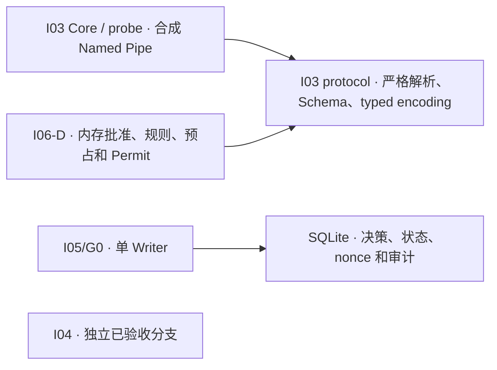

# I06-S 架构预检

下图为实际验收基线，箭头代表已有代码依赖或提交路径。

根 workspace 包含 `crates/core` 和 `crates/protocol`。账本和类型化授权各为独立 Rust workspace。I06-D 没有将账本、进程或 IPC 接到授权路径。I04 在自己的已验收分支中提供从冻结 FixtureId 到分类结果的闭合入口，当前基线中未集成该 crate。

若 S0 解锁，目标路径为 Core 接收合成人工意图，沿用 I06-D 冻结绑定并由唯一 G0 Writer 提交。Broker 验证连接和准备实例，只能使用一次当前启动响应。Worker 仅读取预设虚拟对象。Observer 按 OS 进程身份、退出状态及独立 fixture 摘要提供证据。Core 以持久状态、Worker 报告和独立证据分别对账。

I03 提供本地帧、OS 来源的双端 PID 查询、进程与 token 核验、非继承安全属性及拒绝远程的 Pipe。现行 DACL 给当前 logon SID `GA`，S2 仍需核验更窄的访问掩码、角色到实例的绑定及失败时拒绝。UUID 只能标识逻辑实例。合成进程仍在同 SID 下运行，D01 和 T2-B 边界继续适用。[IPC 基础](../../../crates/core/src/ipc.rs) · [Windows 身份和 Pipe](../../../crates/core/src/windows.rs)

测试数据拟沿用 G0 的 fixture 标记与临时固定盘目录检查。测试数据库、恢复副本和测试 Fence Marker 均为一次性数据，Marker 在恢复数据库之外。保留 G0 的同主体任意 SQL／DDL／文件控制、恶意整体回滚、生产密钥与信任锚、真实 OS 隔离、真实 Agent 外部副作用、物理掉电和生产恢复限制。D01–D05 仍待决，七款 Agent 均为 L0，五项能力均为 false。
