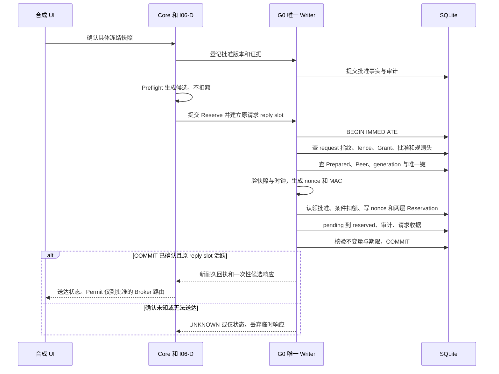
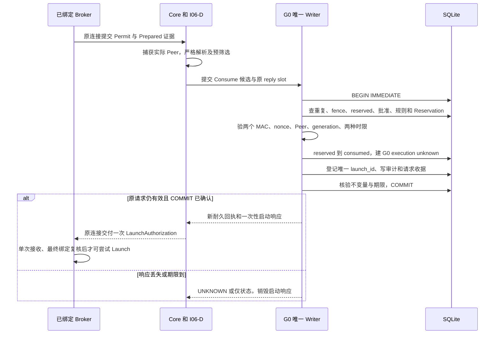
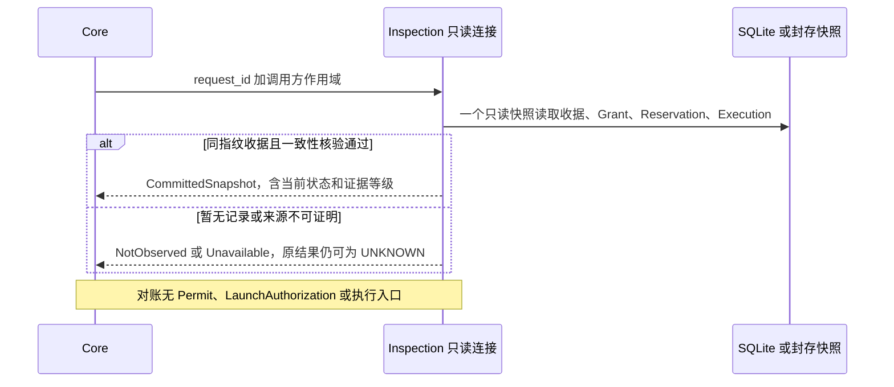

# I06-S Reserve、Consume 与 Reconcile 时序

所有时序是待批准设计。Reserve 与 Consume 共享 G0 的唯一 Writer、单一 SQLite 数据库和事务执行器。已登记的批准和 Prepared 是 Reserve 的前置事实，实际认领及扣额在 Reserve 内生效。[接口 ADR](I06-S-INTERFACE-ADR.md)

## Reserve

1. Core 为原请求分配独立 `request_id`。Writer 在本事务首先查全局请求命名空间。已有同指纹记录则只返回状态，异指纹拒绝。检查 fixture、启动 Fence、当前 policy/grant/core epoch、key generation、OS boot 和 clock domain。旧结果可由 Reconcile 查阅。
2. 复核固定 Decision、G0 输入摘要、`pending` 和当前 eligibility。匹配批准 ID 和活动版本，确认人工来源、Grant／invocation／Prepared 及 scope，验证未撤销、未认领、未过期。若批准明确为 `Parent`，在事务中核对活动规则版本、精确范围、期限、epoch 和余额。无规则的 `OneShot` 仍须认领一份人工批准。
3. 从当前账本记录和 Core 密封证据复核连接、两端实例、序号、Prepared generation、完整快照和 handle manifest。使用 Writer 时钟的一次样本生成 UTC 与 mono 截止点，检查批准、准备、规则上界。分配唯一 Reservation ID、生成原始 nonce、验全局 nonce 哈希唯一。碰撞时在签名前限次重生成，连续异常封锁。按冻结合同生成操作与 Permit MAC。所有待发送字节保持在事务私有内存。
4. `INSERT` 单次认领，匹配规则版本及活动头执行 `used < max_operations` 条件更新并核对受影响行数。插入 nonce、G0 原 Reservation 和 S 扩展，使用 G0 原状态转移与同一对截止点，追加 G0 与 S 审计及请求收据。任一步失败撤销整组。所有计数在提交前检验，最终重核本次绑定和时间，然后提交。
5. 只有确认 COMMIT 后才能产生 `DurableCommitReceipt<Reserve>`。Core 将 response 绑定原 reply slot 与原 Peer 路由，发送前再核对有效性和路由。若 TTL 在 COMMIT 等待或排队期间用尽，可留下已提交的预占和扣额，响应被销毁。后续撤销或失效无退款。重复提交只读状态。

## Consume（Redeem）

1. 重读当前 epoch、fence、原批准和规则头、Grant 状态、Reservation 及 nonce 登记。已消费或已撤销立即拒绝，已预占扣过额度，Consume 不再扣或返还。保留当前批准和规则版本检查，旧版本即使未过期也无法兑换。
2. 最终核验全部 `permit-v2` 字段。用明确 key ID＋generation 依次按冻结域验证 Permit 和 operation MAC。重算 semantic 及最终参数摘要，校验同一 Grant／Decision／invocation、不可变 Reservation ID、nonce 哈希、Prepared／Peer／generation／时钟域，要求签名 UTC 与落库值精确对应，并核验当前 UTC 与 mono 均严格未到截止。可信证据报告准备变化时关闭旧 lease，按同一 Writer 的准备失效命令永久撤回旧授权。错误路由的报文不得代替可信变化证据。
3. 复用 G0 条件状态转移创建 `execution=unknown` 与 G0 execution binding。S 层登记一条 `s_launch_once`，唯一键为 Reservation 和 Grant，`launch_id` 也全局唯一。记录绑定、期限、原会话及审计序号，只保存请求／响应指纹与元数据。事务内构造一次性启动响应，独立审计和请求收据随状态提交。已有启动登记的任何路径都无法再创建响应。
4. `LaunchAuthorization` 只在原 reply slot 内有效，绑定同一 reservation、launch ID、会话序号、Broker／Worker、Prepared、epoch、generation、期限。发送端一次性取走，无重发队列。Broker 接收端以同一活动 Prepared 的单次标记拒绝重复，并在尝试启动前独立复核当前 lease、状态与期限。Broker 不比较 Writer 的进程内 tick。后续阶段须证明跨进程时钟域或一个可验证、只会缩短有效期的本地截止点，证据不足即禁止 Launch。若发送结果未知，状态对账无法让接收端恢复启动。重启销毁所有可尝试启动的本地状态。S1 只做数据级验证。

撤销先提交则 Consume 拒绝，相关批准或 Parent Rule 的撤销也由同一 Writer 串行处理。Consume 先提交则 Grant 保持 `consumed`。若取消在 egress 检查前可见则丢弃响应，已经越过该点的操作按在途取消处理。Cancel ACK 表示收到请求。进程停止、执行成功和实际副作用由独立证据判定。

## Reconcile 与错误分流

| 条件 | 返回与权威状态 |
|---|---|
| 队列未接受、确定在事务外被拒 | `Rejected`，明确未执行。安全失败须重新评估，不做自动重试。 |
| COMMIT 前校验、约束、审计或存储失败，且已确认回滚 | `Rejected`，整个写组未提交。按 G0 策略在存储错误时封锁写入。 |
| COMMIT 返回错误、无法确认回滚，或 Writer 失联 | `Unknown(request_id)`，冻结新授权和未发响应，关闭原 reply slot。即使 SQLite 报 BUSY，设计也禁止隐式重试 COMMIT。恢复后只对账。[SQLite 事务语义](https://www.sqlite.org/lang_transaction.html) |
| Core 已排队但超时、丢失回复或断线 | 对调用方为 UNKNOWN。关闭该 reply slot 并丢弃晚到响应，Writer 可能已提交。只读取单快照。 |
| COMMIT 后崩溃或确认送达失败 | 已提交时可见完整收据及审计。查询只报告观察事实。Consume 已提交但执行证据缺失时，执行为 UNKNOWN。 |
| 同 ID 同指纹重复，或同 Reservation 换 ID 再提交 | 前者返回已存在状态，后者因认领／状态／唯一键拒绝。不同请求指纹与原 ID 冲突时只报告冲突。 |
| Core 或 Writer 重启，或在较旧归档中查询 | 新 activation 的恢复事务使未消费授权失效，保留已消费和可见审计。旧回执仍可查询，旧快照中无记录不能证明未提交。 |

请求指纹只用于幂等检查。已拒绝请求的本代重放由有界、只拒绝的尝试记录处理，达到上限则 fence。任何无收据结果均无签发能力。重启后候选与原连接因 epoch 和 generation 不符被拒绝。真正的新尝试须由用户显式发起，使用新的批准、Grant、Prepared、请求和 nonce，并向用户披露上次未知结果。

## 原子性论证要点

数据库可见的线性化点是单次 COMMIT。Reserve 的认领、计数、Reservation、nonce、状态、审计与收据共同存在或共同缺席。Consume 的状态、执行事实、唯一启动登记、审计与收据同理。通过事务内重读、条件更新、唯一键、外键及领域一致性检查把这个结论落实到每个对象。提交后一次性内存回复的销毁不回滚数据库。读侧只有 `ReconcileView`。此论证覆盖持久化状态和一次性响应的签发，实际启动、取消与外部副作用仍需独立验证。[故障矩阵](I06-S-ATOMICITY-FAULT-MATRIX.md)
